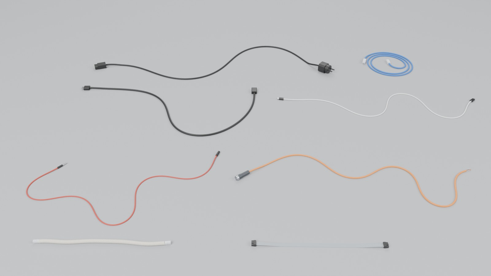
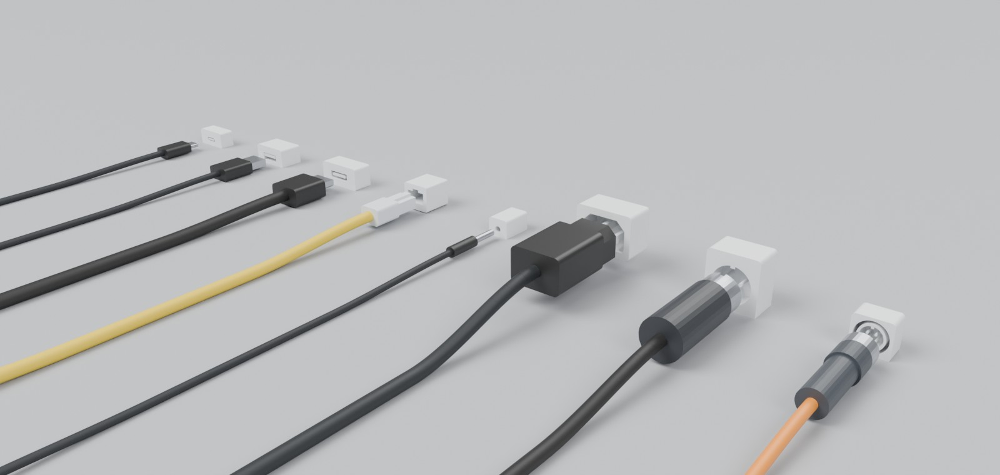
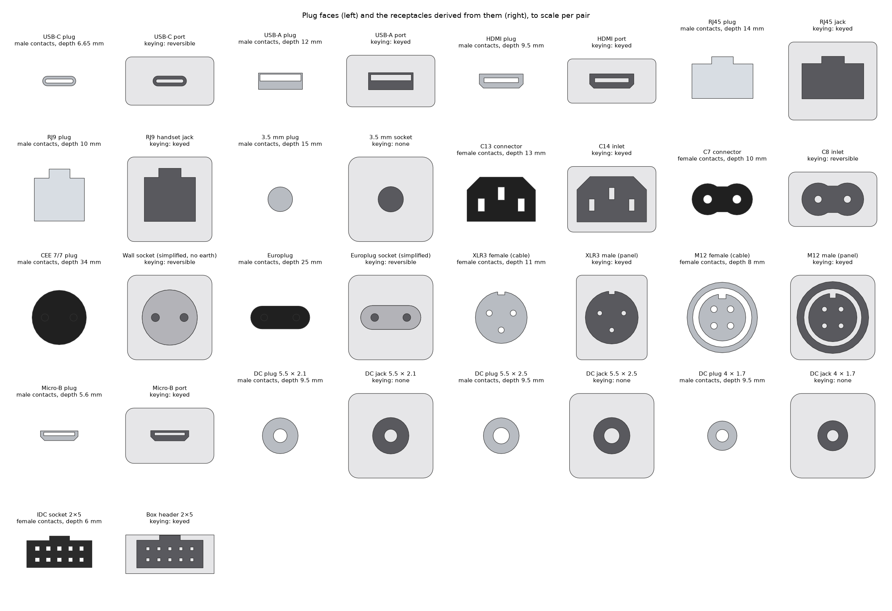
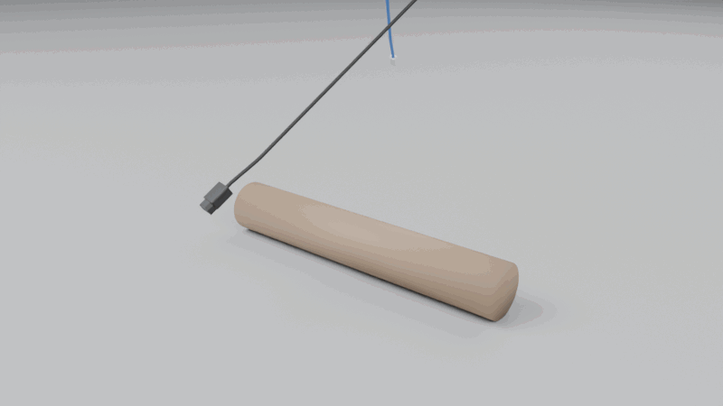

<h1 align="center">
  <picture>
    <source media="(prefers-color-scheme: dark)" srcset="docs/images/logo-dark.svg">
    
  </picture>
</h1>

<p align="center"><strong>Standard cable assets generator for Physical AI.</strong></p>

<p align="center">
  <a href="https://github.com/drscaon/filaire/actions/workflows/ci.yml"></a>
  
  
</p>

Filaire generates cables of standard types (power cords, USB, Ethernet,
HDMI, audio, microphone, speaker wire, sensor, ribbon and coiled handset
cords, DC barrel and Micro-USB) with their real connectors, **male and female**, or with cut or
stripped ends, and exports them to **OpenUSD** as physics-ready assets: a
chain of rigid segments with `UsdPhysics` joints whose springs come from
the cable's bending and torsional stiffness. Every connector comes with the
receptacle it plugs into (device port, inlet, wall socket, panel connector,
or the female end of an extension), derived from the plug so that the two
always mate. The assets are checked in **MuJoCo**: dropped on the ground,
sagging like a beam, and plugged in at the right and wrong angles.

It is built for **Physical AI**: robots that route, plug and unplug cables
are trained and tested in simulation, and they need many different cables
with exact ground truth, not one capsule chain. Everything runs on CPU.
Filaire is the third project of a series, after
[Granulaire](https://github.com/drscaon/granulaire) (granular assets) and
[Maillage](https://github.com/drscaon/maillage) (textiles), and follows the
same approach: distributions instead of one shape, measured outputs, honest
limits.



*One cable of eight presets (power cord with CEE 7/7 plug and IEC C13,
coiled Cat 6 patch cord, HDMI, USB-C, 3.5 mm jack, M12 sensor cable with a
stripped end, coiled handset cord, IDC ribbon), imported from the OpenUSD
files into Blender and rendered with Cycles.*

## What it does

- Generates *N* cables of a preset, **1 m long by default** (`--length` for
  another length, or the preset's retail lengths), lying straight, as a
  slack random curve or coiled on the floor.
- Puts on **each end, independently**, a connector plug, a receptacle on a
  cable (the female end of an extension or a coupler), a clean cut or a
  stripped end with the cores out: 17 connector families, 28 end variants,
  any of them on any cable.
- Models the cable as a **Kirchhoff rod**: rigid segments of 1.5 cable
  widths, joints with twist and bending springs `G·J / L` and `E·I / L`
  computed from the cross-section (round, figure-8 zip cord, flat ribbon;
  coiled cords as a helical spring), real masses.
- Derives every **receptacle from its plug**, layer by layer, with a
  clearance; the keying (any angle, reversible, one orientation) is found
  from the geometry and checked against the standard.
- Exports **OpenUSD**: rigid bodies, joints with drives, convex collision
  parts, a variant set per end (all the end variants of a cable in one
  asset), a `MateFrame` on each connector with its insertion axis, depth,
  clearance, keying and contact gender; and a `sockets.usdc` file with the
  fixed receptacles.
- **Checks the assets in MuJoCo** (`filaire sim-test`), read back from the
  files: drop on the ground, cantilever sag against beam theory, coil
  extension against spring theory, insertion at 0°, 90° and 180°.

## Installation

```bash
python -m venv .venv && source .venv/bin/activate
pip install -e ".[render,sim]"      # add ",dev" for tests and linting
```

Requires Python 3.10+. Dependencies: NumPy, SciPy, Shapely 2.1+ and the
OpenUSD bindings (`usd-core`); matplotlib for the previews, MuJoCo for the
checks.

## Usage

```bash
filaire list                                         # presets
filaire ends                                         # every end variant
filaire generate --preset usb_c                      # 6 cables, 1 m each
filaire generate --preset ethernet --length 3 --layout coil
filaire generate --preset power_c13 --end-a c13_plug --end-b stripped
filaire generate --preset usb_c --end-a usb_c_plug --end-b usb_c_inline   # an extension cord
filaire generate --preset hdmi --length preset --count 12 --seed 4        # retail lengths
filaire generate --preset audio_jack --color "#c0392b" --modulus 45
filaire preview output/usb_c                         # top view (matplotlib)
filaire connectors --out connectors.png              # plug faces and receptacles
filaire sim-test output/usb_c                        # MuJoCo checks
```

`python -m filaire ...` works too. From Python:

```python
from filaire import generate_scene, write_outputs

cables = generate_scene("usb_c", count=6, seed=1)  # 1 m, ends drawn from the preset
write_outputs(cables, "output")  # -> output/usb_c/

# 2.5 m power cords coiled on the floor, C13 on one end and a stripped end on the other
cords = generate_scene(
    "power_c13", count=4, length=2.5, layout="coil", ends={"a": "c13_plug", "b": "stripped"}
)
write_outputs(cords, "output")
```

### Options of `filaire generate`

| Option | Default | Effect |
|---|---|---|
| `--preset` | `usb_c` | cable type (table below) |
| `--count N`, `--seed S` | 6, 1 | number of cables, random seed; same options and seed give the same cables |
| `--length L` | `1` | length in m of every cable; `preset` draws the preset's retail lengths (± tolerance) |
| `--end-a V`, `--end-b V` | preset's draw | end variant of each end, independently: any `filaire ends` entry, on any cable |
| `--layout` | preset's draw | `straight`, `slack` (random smooth curve) or `coil` (flat spiral on the floor) |
| `--color "#rrggbb"` | preset's draw | jacket colour of every cable |
| `--modulus E` | preset's draw | effective Young's modulus of the cable in MPa (sets the stiffness) |
| `--max-segments N` | 400 | upper bound on the rigid segments per cable (longer segments beyond it) |
| `--no-vary-…` | | turn one random aspect off, the others unchanged: `layout`, `ends`, `color`, `stiffness`, `density`, `length` |

Each random aspect has its own stream: turning one off or forcing it leaves
the others as they were (same layouts with plain colours, same colours with
other ends…).

### Presets

| Category | Preset | Cross-section | End A | End B (default draw) |
|---|---|---|---|---|
| Power | `power_c13` | round Ø6.4 mm, 3 cores | C13 | CEE 7/7 plug, C14 (extension), stripped |
| | `power_c7` | figure-8, 2 × Ø3.4 mm | C7 | Europlug, stripped |
| | `dc_barrel` | figure-8, 2 × Ø2.4 mm | DC plug 5.5 × 2.1, 5.5 × 2.5 or 4.0 × 1.7 | stripped, cut, DC jack (extension) |
| Data | `usb_c` | round Ø4.0 mm | USB-C plug | USB-C plug, USB-C receptacle (extension) |
| | `usb_a_to_c` | round Ø3.8 mm | USB-A plug | USB-C plug |
| | `usb_micro` | round Ø3.5 mm | USB-A plug | Micro-B plug |
| | `ethernet` | round Ø6.0 mm, 4 pairs | RJ45 plug | RJ45 plug, RJ45 coupler |
| | `hdmi` | round Ø7.0 mm | HDMI plug | HDMI plug, HDMI receptacle (extension) |
| Audio | `audio_jack` | round Ø3.5 mm | 3.5 mm plug | 3.5 mm plug, 3.5 mm socket (extension) |
| | `xlr_mic` | round Ø6.0 mm | XLR3 female | XLR3 male |
| | `speaker_wire` | figure-8, 2 × Ø3.2 mm | stripped, cut | stripped, cut |
| Industrial | `m12_sensor` | round Ø5.0 mm, PUR | M12 female | stripped, cut |
| | `ribbon_idc` | flat, 10 × 1.27 mm | IDC socket 2 × 5 | IDC socket, cut |
| Telephone | `coiled_handset` | coil Ø8.5 mm of Ø2.8 mm wire | RJ9 plug | RJ9 plug |

Every cable also carries `cut` and `stripped` variants on both ends, and any
other variant forced with `--end-a` / `--end-b`. Diameters, densities
(8–90 g/m) and moduli (20–300 MPa, drawn per cable) are realistic orders of
magnitude, not measurements of a specific product.

## Connectors



*USB-C, USB-A, HDMI, RJ45, 3.5 mm, C13, XLR3 and M12 plugs in front of the
fixed receptacles derived from them (`sockets.usdc`), rendered in Blender.*

| Family | Cable side (plug) | Contacts | Receptacle on a cable | Fixed receptacle | Keying | Depth |
|---|---|---|---|---|---|---|
| `usb_c` | USB-C plug | male | USB-C receptacle | USB-C port | reversible | 6.65 mm |
| `usb_a` | USB-A plug | male | | USB-A port | keyed | 12 mm |
| `usb_micro` | Micro-B plug | male | | Micro-B port | keyed | 5.6 mm |
| `hdmi_a` | HDMI plug | male | HDMI receptacle | HDMI port | keyed | 9.5 mm |
| `rj45` | RJ45 plug | male | RJ45 coupler | RJ45 jack | keyed | 14 mm |
| `rj9` | RJ9 plug | male | | RJ9 handset jack | keyed | 10 mm |
| `jack35` | 3.5 mm plug | male | 3.5 mm socket | 3.5 mm socket | none | 15 mm |
| `c13` | C13 connector | **female** | C14 plug | C14 inlet | keyed | 13 mm |
| `c7` | C7 connector | **female** | | C8 inlet | reversible | 10 mm |
| `cee77` | CEE 7/7 plug | male | | wall socket (simplified) | reversible | 34 mm |
| `cee716` | Europlug | male | | Europlug socket (simplified) | reversible | 25 mm |
| `xlr3` | XLR3 female | **female** | XLR3 male | XLR3 male (panel) | keyed | 11 mm |
| `m12a` | M12 A-coded female | **female** | | M12 male (panel) | keyed | 8 mm |
| `idc10` | IDC socket 2 × 5 | **female** | | box header 2 × 5 | keyed | 6 mm |
| `dc5521`, `dc5525`, `dc4017` | DC plug 5.5 × 2.1, 5.5 × 2.5, 4.0 × 1.7 mm | male | DC jack | DC jack | none | 9.5 mm |

**Gender and role are kept apart.** *Gender* is the contact gender of the
standard; *role* is geometric: the plug enters, the receptacle receives. An
IEC C13 has female contacts but enters the C14 inlet; an XLR3 female enters
the shell of the male. `filaire:contactGender` and `filaire:role` say both.

**The receptacle is derived from the plug.** Each plug is described by its
cross-sections, layer by layer from the tip (a CEE 7/7 plug: two pins, then
the round face that enters the socket's recess). In each layer, the
receptacle's solid is its outline minus the plug's cross-section grown by
the clearance (0.05–0.3 mm). The plug's holes become the receptacle's pins
or tongue, the plug's key becomes the keyway, and the two always mate. The
keying is then *found* by turning the plug in 15° steps and testing for
overlap, and a test checks it against the standard's.

The same test answers which plug goes into which receptacle across families
(`fits(plug, angle, socket=other)`). For the DC barrels it gives the real
behaviour: the derived jacks get a centre pin from the plug's bore, so a
5.5 × 2.5 mm plug goes loosely onto a 5.5 × 2.1 mm jack, while a 5.5 × 2.1 mm
plug is stopped by the thicker pin of a 5.5 × 2.5 mm jack.



*`filaire connectors`: the plug seen from its tip (left) and the fixed
receptacle seen from the front (right): opening in dark, pins and tongues in
light grey.*

Dimensions come from published figures where they could be found (USB-C
receptacle opening and insertion length, HDMI plug and receptacle, RJ45 and
RJ9 widths and heights, 3.5 mm diameter and length, CEE 7 pins and recess
depth, IEC 60320 pin spacing, Micro-B receptacle opening, DC barrel diameters
and the 4.0 × 1.7 mm barrel length); the others (XLR, M12, IDC, C13 face,
Micro-B chamfers, 5.5 mm barrel length, inner cavities, overmolds) are **approximate** and marked so in
[`connectors.py`](src/filaire/connectors.py), each with its sources. The
standards themselves were not consulted. Connectors are simplified: no
latches that move, no threads, no contacts inside the holes, no logos.

## Outputs (per preset, under `output/<preset>/`)

| File | Content |
|---|---|
| `filaire_<preset>.usdc` | the cables (OpenUSD, Blender: File > Import > USD) |
| `sockets.usdc` | one fixed receptacle per connector family used by the cables |
| `cables.csv` | per cable: layout, length, ends, colour, modulus, densities, stiffness, segments, masses |
| `summary.json` | counts by layout, end and colour; length, mass, stiffness and segment ranges |
| `sheet.png` | top view (`filaire preview`) |
| `sim_test/sim_test.json` | MuJoCo report (`filaire sim-test`) |

### OpenUSD layout

Z up, metres, kilograms, `/World` the default prim.

```
/World
  /PhysicsScene                  gravity
  /Looks, /PhysicsMaterials      UsdPreviewSurface materials; friction and restitution
  /Cables/<cable>                Xform, PhysicsArticulationRootAPI, filaire:* attributes,
                                 variant sets "end_a" and "end_b"
    /Segments/seg_000 …          rigid bodies (RigidBodyAPI, MassAPI), segment frame: x along the cable
      /Collision                 Capsule along x (round, coiled) or Cube (flat, figure-8), purpose guide
      /Visual                    the piece of tube this segment carries
    /Joints/joint_000 …          PhysicsJoint: translations locked (coiled: transX free),
                                 drives rotX (twist), rotY, rotZ (bending) [, transX (coil)]
    /End_A, /End_B               filled by the selected variant:
      /Body                      rigid body of the connector or stripped end
        /Visual_*                meshes (shell, body, cores, copper)
        /Collision/hull_00 …     convex parts (MeshCollisionAPI convexHull, purpose guide)
        /MateFrame               origin on the mating plane, +Z = insertion direction
      /Attach                    PhysicsFixedJoint to the end segment
  /Ground                        collision plane
```

Selecting a variant (`end_b = "usb_c_inline"`, `"cut"`…) swaps the end, its
collision parts and its joint. Angular drives use UsdPhysics units
(stiffness per degree); the same values per radian and the rod's stiffness
are kept as engine-neutral attributes:

| Attribute (on the cable) | Content |
|---|---|
| `filaire:bendingStiffness` | E·I about the width axis and about the height axis (N·m²) |
| `filaire:torsionalStiffness` | G·J (N·m²) |
| `filaire:jointStiffness` | per joint: twist, bend y, bend z (N·m/rad) |
| `filaire:youngsModulus`, `filaire:shearModulus`, `filaire:linearDensity` | material (Pa, kg/m) |
| `filaire:segmentLength`, `filaire:segmentCount`, `filaire:restShape` | discretisation; rest shape is straight |
| `filaire:dampingTime` | joint damping = stiffness × 0.01 s |
| `filaire:coil:*`, `filaire:axialStiffness` | coiled cords: coil diameter, pitch, turns, wire length; spring k (N/m) |
| `filaire:length`, `filaire:layout`, `filaire:profile`, `filaire:jacket`, … | what the cable is |

| Attribute (on a `MateFrame`) | Content |
|---|---|
| `filaire:connector`, `filaire:name`, `filaire:standard` | family and name (`usb_c`, "USB-C plug") |
| `filaire:role`, `filaire:mount`, `filaire:contactGender` | plug / receptacle, cable / panel, male / female |
| `filaire:insertionDepth`, `filaire:clearance`, `filaire:keying` | for insertion tasks (m) |

## Physics model

- **Rod.** The cable is a chain of N rigid segments (length ≈ 1.5 cable
  widths, at most 400 per cable). Consecutive segments share a joint at
  their common end point with three rotational springs: twist `G·J / L`,
  bending `E·I_y / L` and `E·I_z / L`, the discrete Kirchhoff rod. `E·I` and
  `G·J` come from the cross-section (polygon second moments, so a flat
  ribbon is a hundred times softer across its thickness than across its
  width) and an effective modulus drawn per cable; `G = E / (2 (1 + ν))`,
  ν = 0.45. The rest shape is straight; the authored pose (slack, coiled) is
  a deformed state.
- **Coiled cords** are modelled along their axis, as a helical spring seen
  as a rod (Wahl's close-coiled formulas): bending `2 E I p / (π D (2 + ν))`,
  twist `E I p / (π D)`, and an axial spring `4 G J / (π D³ n)` shared by
  free `transX` joints. The coil itself is in the visual mesh.
- **Masses** from the linear density; connectors from the volume of their
  parts and an effective density; inertia tensors from the meshes.

## MuJoCo checks

`filaire sim-test output/<preset>` reads the OpenUSD files back (not the
generator's objects) and runs, on CPU:

| Check | What | Pass when |
|---|---|---|
| drop | the first cables, with their selected ends, lifted 1 cm and dropped for 3 s in their authored layout | finite, ground penetration below half the cable radius after the impact, all bodies slower than 5 cm/s at the end |
| sag | a sample of the cable clamped at one end, sagging ≈ 10 % of its length under its own weight; `E·I` read back from the joint drives | tip deflection within 5 % of `w L⁴ / (8 E I)` |
| coil | coiled cords: the coil hanging from its top | extension within 5 % of `W / (2 k)` |
| insertion | each plug pushed along its axis (5 N max) into the fixed receptacle and the receptacle on a cable, at 0°, 90° and 180° | goes fully in at the angles its keying allows, stopped before 60 % of the depth at the others |

For speed, the drop test simulates the cable with at most 60 links (groups
of segments merged, springs in series, same `E·I`) and without the twist
hinge: in generalised coordinates a chain's mass matrix is dense and a step
costs the cube of its joints. Each joint gets an armature (added inertia)
and critical damping so that stiff, light links stay stable with a 1 ms
step; neither changes a static equilibrium, which is what the sag and coil
checks compare.



*Power cord, Cat 6, USB-C, 3.5 mm jack and M12 sensor cable (70 cm),
steeply tilted and dropped together onto a bar: one end hits first, the
cables fold over the bar and over each other, connectors attached, and come
to rest. Simulated in MuJoCo from the OpenUSD files (rest shape straight,
60 links per cable, 0.5 ms step), rendered in Blender:
[`scripts/drop_gif.py`](scripts/drop_gif.py).*

### Results

`filaire generate --preset <p> --count 3` (1 m cables, seed 1) then
`filaire sim-test output/<p> --cables 3`, MuJoCo 3.17, one CPU core:

| Preset | Segments | `E·I` (N·m²) | Mass with ends (g) | Drop (max speed, penetration) | Stiffness check | Insertion |
|---|---|---|---|---|---|---|
| `power_c13` | 104 | 0.0049–0.0073 | 119–187 | 3/3 (0.004 m/s, 0.10 mm) | sag −0.8 % | C13 panel + inline, CEE 7/7 ✓ |
| `power_c7` | 98 | 0.00066–0.00098 | 49–67 | 3/3 (0.002 m/s, 0.06 mm) | sag −0.8 % | C7, Europlug ✓ |
| `dc_barrel` | 139 | 0.00016–0.00026 | 30–33 | 3/3 (0.012 m/s, 0.09 mm) | sag −0.8 % | three DC jacks ✓ |
| `usb_c` | 167 | 0.00050–0.00080 | 46–50 | 3/3 (0.013 m/s, 0.18 mm) | sag −0.8 % | USB-C panel + inline ✓ |
| `usb_a_to_c` | 175 | 0.00041–0.00065 | 43–46 | 3/3 (0.004 m/s, 0.18 mm) | sag −0.8 % | USB-A, USB-C ✓ |
| `usb_micro` | 190 | 0.00029–0.00051 | 38–40 | 3/3 (0.004 m/s, 0.10 mm) | sag −0.8 % | USB-A, Micro-B ✓ |
| `ethernet` | 111 | 0.0050–0.0072 | 61–70 | 3/3 (0.005 m/s, 0.07 mm) | sag −0.8 % | RJ45 panel + inline ✓ |
| `hdmi` | 95 | 0.0094–0.0139 | 99–107 | 3/3 (0.005 m/s, 0.09 mm) | sag −0.8 % | HDMI panel + inline ✓ |
| `audio_jack` | 190 | 0.00022–0.00036 | 20–22 | 3/3 (0.003 m/s, 0.13 mm) | sag −0.8 % | 3.5 mm panel + inline ✓ |
| `xlr_mic` | 111 | 0.0013–0.0022 | 147–151 | 3/3 (0.007 m/s, 0.06 mm) | sag −0.8 % | XLR3 panel + inline ✓ |
| `speaker_wire` | 104 | 0.00042–0.00067 | 52–55 | 3/3 (0.024 m/s, 0.07 mm) | sag −0.8 % | (stripped / cut ends) |
| `m12_sensor` | 133 | 0.0015–0.0023 | 65–68 | 3/3 (0.004 m/s, 0.03 mm) | sag −0.8 % | M12 ✓ |
| `ribbon_idc` | 52 | 0.00011–0.00017 | 14–16 | 3/3 (0.007 m/s, 0.06 mm) | sag −0.8 % | IDC ✓ |
| `coiled_handset` | 59 | (coil) | 130–139 | 3/3 (0.004 m/s, 0.07 mm) | coil −0.0 % | RJ9 ✓ |

Every keyed connector was stopped at 90° and 180° (at most 12 % of its
depth, the IDC socket's flat face entering a little before its key meets the
header), every reversible one went in at 180°, the 3.5 mm jack at every
angle, like the DC barrels. The sag is 0.8 % under the linear beam formula for every cable: the
geometric nonlinearity of a 10 % deflection, the same for all since the
sample length is scaled to the stiffness. Generation takes 1–4 s per
preset (3 cables), the checks 15–30 s (a minute for the coiled cords).

## Limits

- **Not calibrated.** Moduli and densities are orders of magnitude; no
  cable's `E·I` was measured. The sag check proves the export is consistent
  with the model, not that the model matches a real cable.
- **Approximate connectors.** See [Connectors](#connectors): simplified
  outlines, no moving latches, threads or contacts; several dimensions not
  from a source.
- **Elastic, straight rest shape.** No plastic set (a real cable keeps its
  coils), no initial tension in coiled cords, no knots.
- **Tested in MuJoCo only.** The files follow the standard `UsdPhysics`
  schemas (rigid bodies, D6 joints with drives, articulation root, convex
  hulls); they have not been loaded in Isaac Sim / PhysX here (no NVIDIA
  GPU), where drive units and articulation behaviour may need adjusting.
- **Visual per segment.** Each segment carries its piece of tube, so a
  simulated cable shows small creases at the joints when it bends.

## Roadmap

1. Calibration against measured bending stiffness (three-point bending or
   cantilever tests) for a few real cables per preset.
2. Plastic set and pre-coiled rest shapes; tied bundles and hanks.
3. A PhysX test in Isaac Sim, and MJCF export with MuJoCo's cable plugin.
4. More connectors (USB micro-B, DisplayPort, DC barrel, Schuko and French
   sockets with their earth contacts, M8, D-sub) and snap-fit latches.
5. Insertion tasks: forces, misalignment tolerances, success labels.

## Development

The project follows **GitHub Flow**:

1. `main` is always releasable and protected: changes reach it only through
   pull requests, nobody pushes to it directly.
2. Every change starts on a short-lived branch from `main`, named after its
   type: `feat/<name>`, `fix/<name>`, `docs/<name>`, `ci/<name>`, …
3. Push the branch and open a pull request into `main`; CI runs on it.
4. Merge when CI is green, then delete the branch.

Releasing is a change like any other: on a `chore/release-X.Y.Z` branch, bump
`version` in `pyproject.toml` and move the `Unreleased` entries of
`CHANGELOG.md` under the new version; merge the pull request, then tag
`vX.Y.Z` on `main`. The release workflow builds the packages and attaches
them to the GitHub release.

A versioned `pre-push` hook refuses direct pushes to `main`. Enable it once per
clone with `git config core.hooksPath .githooks` (emergency override:
`ALLOW_MAIN_PUSH=1 git push`).

The README images are made by [`scripts/`](scripts/): `make_logo.py` (logo),
`readme_images.py` (Blender renders through `bpy`, connector sheet, GitHub
social preview `docs/images/social_preview.png`, to upload in the
repository's Settings > General > Social preview).

### Continuous integration

| Workflow | When | What |
|---|---|---|
| `ci.yml` | every push to `main`, every pull request | `ruff check` and `ruff format --check`; `pytest` on Python 3.10–3.13 (Linux) and 3.12 (macOS, Windows); a command-line smoke test; **the MuJoCo checks of every preset**, reports kept as a run artifact; build the wheel and sdist, `twine check`, install the wheel in a clean environment. |
| `release.yml` | a pushed tag `v*` | checks the tag matches the version in `pyproject.toml`, tests, builds, then creates the GitHub release with the packages attached and the notes taken from `CHANGELOG.md`. Versions with `a`, `b` or `rc` are marked as pre-releases. |
| Dependabot | monthly | pull requests to update the GitHub Actions and the Python dependencies. |

## License

[MIT](LICENSE) © 2026 Daniel Régis Sarmento Caon

The logo is drawn from DejaVu Sans Bold outlines (Bitstream Vera license),
converted to paths, so it displays without the font installed.
