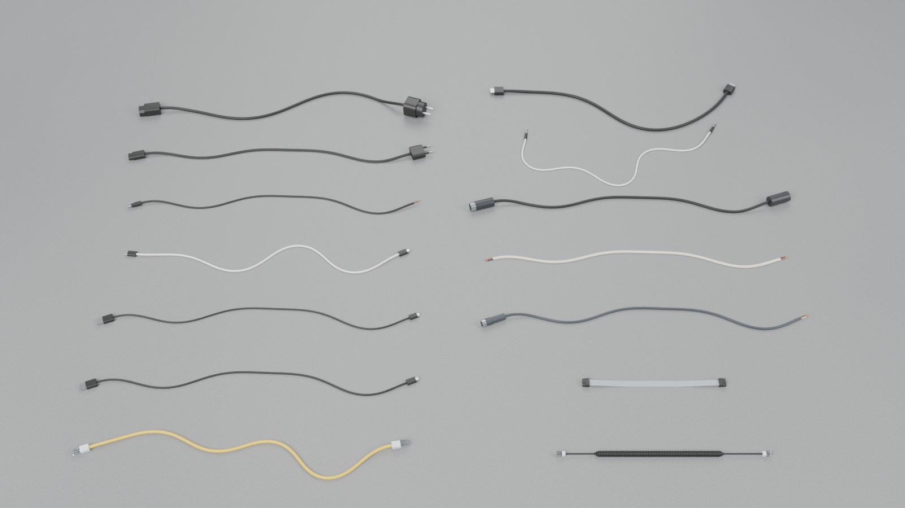
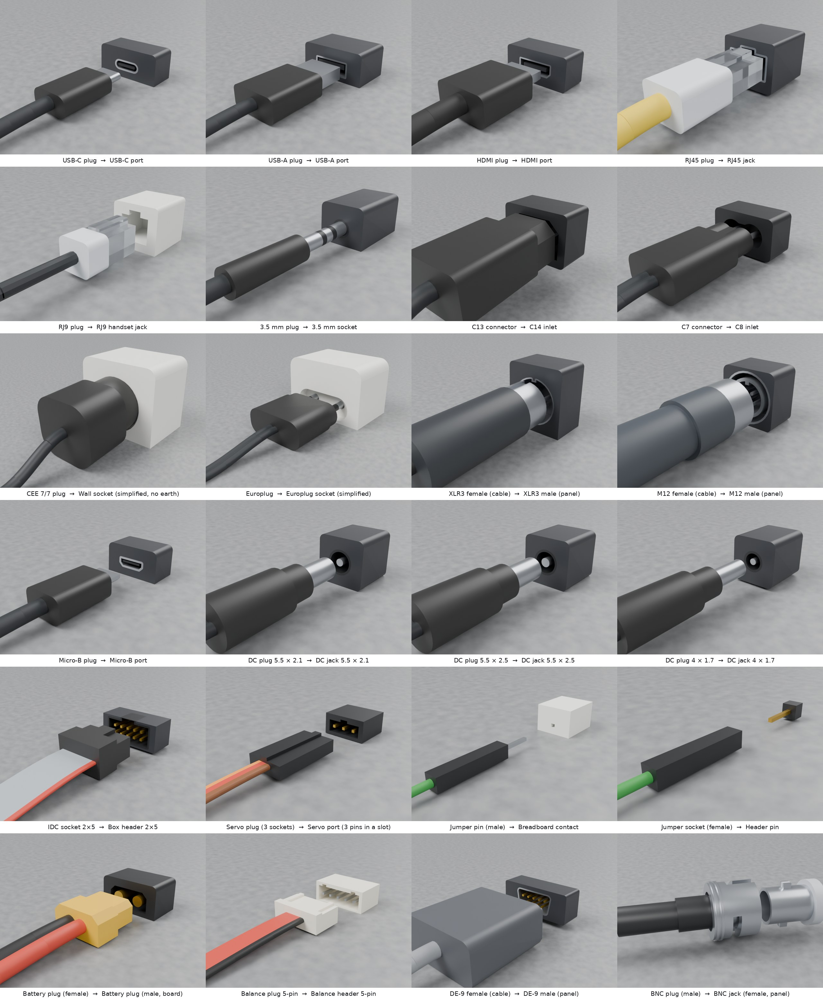

<h1 align="center">
  <picture>
    <source media="(prefers-color-scheme: dark)" srcset="https://raw.githubusercontent.com/drscaon/filaire/main/docs/images/logo-dark.svg">
    
  </picture>
</h1>

<p align="center"><strong>Standard cable assets generator for Physical AI.</strong></p>

<p align="center">
  <a href="https://github.com/drscaon/filaire/actions/workflows/ci.yml"></a>
  <a href="https://pypi.org/project/filaire/"></a>
  
  
  <a href="https://primvaria.com"></a>
</p>

Filaire generates cables of standard types (power cords, USB, Ethernet,
HDMI, audio, microphone, speaker wire, sensor, ribbon and coiled handset
cords, DC barrel and Micro-USB, CAN bus, BNC coaxial leads, and the leads of robots and
drones: servo, battery, balance and jumper wires) with their real connectors, **male and female**, or with cut or
stripped ends, and exports them to **OpenUSD** as physics-ready assets: a
chain of rigid segments with `UsdPhysics` joints whose springs come from
the cable's bending and torsional stiffness. Every connector comes with the
receptacle it plugs into (device port, inlet, wall socket, panel connector,
or the female end of an extension), derived from the plug so that the two
always mate. The assets are checked in **MuJoCo** (dropped on the ground,
sagging like a beam, plugged in at the right and wrong angles) and in
**Blender**, where an add-on sets the rigid bodies and joints up by itself
when a file is imported. Every file passes OpenUSD's own validators.

It is built for **Physical AI**: robots that route, plug and unplug cables
are trained and tested in simulation, and they need many different cables
with exact ground truth, not one capsule chain. Everything can run on CPU.
Filaire is part of [**Primvaria**](https://primvaria.com), with
[Granulaire](https://github.com/drscaon/granulaire) (granular assets),
[Maillage](https://github.com/drscaon/maillage) (textiles) and
[Quincaillerie](https://github.com/drscaon/quincaillerie) (fasteners, cells
and holders), and follows the same approach: distributions instead of one
shape, measured outputs, honest limits.



*One cable of each of the 20 presets, 30 to 50 cm long, with its usual ends (left: power cords
C13 and C7, DC barrel, USB-C, USB-A to C, USB-A to Micro-B, Ethernet, HDMI,
3.5 mm jack, XLR microphone cable; right: speaker wire, M12 sensor cable, IDC
ribbon, CAN bus, BNC coaxial lead, servo lead, jumper wire, battery lead, balance lead, coiled
handset cord), imported from the OpenUSD files into Blender
and rendered with Cycles.*

## What it does

- Generates *N* cables of a preset, **1 m long by default** (`--length` for
  another length, or the preset's retail lengths), lying straight, as a
  slack random curve or coiled on the floor.
- Puts on **each end, independently**, a connector plug, a receptacle on a
  cable (the female end of an extension or a coupler), a clean cut or a
  stripped end with the cores out: 24 connector families, 40 end variants,
  any of them on any cable.
- Models the cable as a **Kirchhoff rod**: rigid segments of 1.5 cable
  widths, joints with twist and bending springs `G·J / L` and `E·I / L`
  computed from the cross-section (round, figure-8 zip cord, flat ribbon;
  coiled cords as a helical spring), real masses.
- Derives every **receptacle from its plug**, layer by layer, with a
  clearance; the keying (any angle, every quarter turn, reversible, one orientation) is found
  from the geometry and checked against the standard. A **bayonet** (BNC) locks with a
  quarter turn: its receptacle keeps clear of everything the plug sweeps, pushed in then
  turned, and its studs are what is left.
- Exports **OpenUSD**: one rigid body per segment and per connector, each
  with *one* visual mesh (so every DCC imports one object per body), mass,
  centre of mass and inertia, convex collision parts, joints with drives,
  a variant set per end (all the end
  variants of a cable in one asset), a `MateFrame` on each connector with
  its insertion axis, depth, clearance, keying, contact gender and, for a
  bayonet, the locking turn; and a
  `sockets.usdc` file with the fixed receptacles. The files hold nothing
  specific to an engine: what only PhysX reads (Isaac Sim) is a layer over
  each file, `<file>_physx.usda`. `--no-physics` writes visual assets only. Every file passes the OpenUSD validators
  (`UsdValidation`).
- **Checks the assets in MuJoCo** (`filaire sim-test`), read back from the
  files: drop on the ground, cantilever sag against beam theory, coil
  extension against spring theory, insertion at 0°, 90° and 180°, and a
  bayonet's lock: pushed in, turned, then pulled.
- **A Blender add-on** (`filaire blender-addon`): rigid bodies and
  constraints set up on every USD import, and the same drop check in
  Blender (`filaire blender-test`).

## Engines

Every file is OpenUSD with standard `UsdPhysics` schemas. Where each engine
stands, as on the [Primvaria engine matrix](https://primvaria.com/#engines):

| Engine | Status |
|---|---|
| OpenUSD validators (`usdchecker`) | **tested**: every preset, with and without physics, in CI |
| Blender | **tested**: every preset dropped through the add-on (`filaire blender-test`) |
| MuJoCo | **tested**: drop, cantilever sag, coil, insertion of every preset (`filaire sim-test`) |
| NVIDIA Isaac Sim (PhysX) | not tested yet (needs an NVIDIA RTX GPU); `UsdPhysics` joints, PhysX settings in a layer over each file |

## Installation

From PyPI:

```bash
pip install "filaire[render,sim]"
```

From a clone, for development:

```bash
python -m venv .venv && source .venv/bin/activate
pip install -e ".[render,sim]"      # add ",dev" for tests and linting
```

Requires Python 3.11+. Dependencies: NumPy, SciPy, Shapely 2.1+ and the
OpenUSD bindings (`usd-core` 26.5+); matplotlib for the previews, MuJoCo for the
checks. The Blender checks need Blender as a Python module
(`pip install -e ".[blender]"`, Python 3.13 only) or a Blender executable.

Earlier `usd-core` wheels generate the same files, but their OpenUSD
validators do not load (25.5 ships without the validator
libraries, 25.8 and 25.11 without the UsdPreviewSurface definitions), and CI
tests both 26.5 and the newest release.

## Usage

```bash
filaire list                                         # presets
filaire ends                                         # every end variant
filaire generate --preset usb_c                      # 6 cables, 1 m each
filaire generate --preset ethernet --length 3 --layout coil
filaire generate --preset power_c13 --end-a c13_plug --end-b stripped
filaire generate --preset usb_c --end-a usb_c_plug --end-b usb_c_inline   # an extension cord
filaire generate --preset hdmi --length preset --count 12 --seed 4        # retail lengths
filaire generate --preset audio_jack --color "#c0392b" --modulus 45
filaire preview output/usb_c                         # top view (matplotlib)
filaire connectors --out connectors.png              # plug faces and receptacles
filaire generate --preset hdmi --no-physics          # visual assets only
filaire sim-test output/usb_c                        # MuJoCo checks
filaire blender-test output/usb_c                    # the drop check in Blender (add-on)
filaire blender-addon                                # filaire_physics.zip, for Blender 4.4+
```

`python -m filaire ...` works too. From Python:

```python
from filaire import generate_scene, write_outputs

cables = generate_scene("usb_c", count=6, seed=1)  # 1 m, ends drawn from the preset
write_outputs(cables, "output")  # -> output/usb_c/

# 2.5 m power cords coiled on the floor, C13 on one end and a stripped end on the other
cords = generate_scene(
    "power_c13", count=4, length=2.5, layout="coil", ends={"a": "c13_plug", "b": "stripped"}
)
write_outputs(cords, "output")
```

Four short scripts in [`examples/`](https://github.com/drscaon/filaire/tree/main/examples)
show the rest, each explained by its own comments: a first pack and its
ground truth, one aspect switched off, reading the file with OpenUSD alone,
and the sag and drop checks in MuJoCo.

## Connectors



*The 24 connector families: each plug on a short piece of its cable, 15 mm
in front of the fixed receptacle derived from it (`sockets.usdc`), rendered
in Blender.*

Dimensions, sources, keying and what is simplified, family by family:
[Connectors](https://github.com/drscaon/filaire/blob/main/docs/connectors.md).

## Outputs (per preset, under `output/<preset>/`)

| File | Content |
|---|---|
| `filaire_<preset>.usdc` | the cables (OpenUSD, Blender: File > Import > USD) |
| `sockets.usdc` | one fixed receptacle per connector family used by the cables |
| `filaire_<preset>_physx.usda`, `sockets_physx.usda` | the same files with the PhysX settings (Isaac Sim): a layer over each file, to open instead of it, see [PhysX layer](https://github.com/drscaon/filaire/blob/main/docs/openusd.md#physx-layer) |
| `instances.csv` | one row per cable and per socket, read back from the files: its identity, its classes (the [semantic labels](https://github.com/drscaon/filaire/blob/main/docs/openusd.md) renderers turn into segmentation masks), **every drawn value** (`variation:<name>`) and **every measured value** (`measured:<name>`), then the jacket: the ground truth |
| `manifest.json` | what the pack is (contract, generator, version, preset, seed, aspects, files) and its summary: counts by layout, end and colour; length, mass, stiffness and segment ranges |
| `sheet.png` | top view (`filaire preview`) |
| `sim_test/sim_test.json` | MuJoCo report (`filaire sim-test`) |
| `sim_test/blender_setup.json`, `sim_test/blender_naive.json` | Blender reports and their scenes (`filaire blender-test`) |

## Limits

The short version; the full list is in [Limits and roadmap](https://github.com/drscaon/filaire/blob/main/docs/limits.md).

- Stiffness and density are orders of magnitude, **not calibrated**: no
  cable's `E·I` was measured. A ruler is enough to
  [check a preset against a real cable](https://github.com/drscaon/filaire/blob/main/docs/physics.md#checking-a-preset-against-a-real-cable).
- Connectors are simplified outlines: no moving latches, threads or contacts.
- Cables are elastic with a straight rest shape: no plastic set.
- Checked in MuJoCo and Blender; **not tested in Isaac Sim yet**.

## Development

```bash
git clone https://github.com/drscaon/filaire.git && cd filaire
pip install -e ".[dev]"
pytest
```

Conventions and continuous integration: [Development](https://github.com/drscaon/filaire/blob/main/docs/development.md).

## Documentation

| Page | What it holds |
|---|---|
| [Usage in depth](https://github.com/drscaon/filaire/blob/main/docs/usage.md) | Every option of `filaire generate` and the preset list. |
| [Connectors](https://github.com/drscaon/filaire/blob/main/docs/connectors.md) | The 24 connector families and their end variants: dimensions, sources, keying, and what is simplified. |
| [OpenUSD layout and contract](https://github.com/drscaon/filaire/blob/main/docs/openusd.md) | How a cable is laid out in the file, the ground and physics scene, and what the Primvaria contract writes on every cable. |
| [Physics: model and checks](https://github.com/drscaon/filaire/blob/main/docs/physics.md) | The rod model, the Blender add-on, the MuJoCo and Blender checks with their results, and how to check a preset against a real cable. |
| [Limits and roadmap](https://github.com/drscaon/filaire/blob/main/docs/limits.md) | Everything Filaire does not do or has not verified, stated plainly, and what comes next. |
| [Development](https://github.com/drscaon/filaire/blob/main/docs/development.md) | Branch and release conventions, continuous integration. |

## License

[MIT](https://github.com/drscaon/filaire/blob/main/LICENSE) © 2026 Daniel Régis Sarmento Caon

The logo is drawn from DejaVu Sans Bold outlines (Bitstream Vera license),
converted to paths, so it displays without the font installed.

---

Filaire is part of [**Primvaria**](https://primvaria.com), physics-ready variability for Physical AI, in OpenUSD: `pip install primvaria` installs the whole suite ([source](https://github.com/drscaon/primvaria)).
