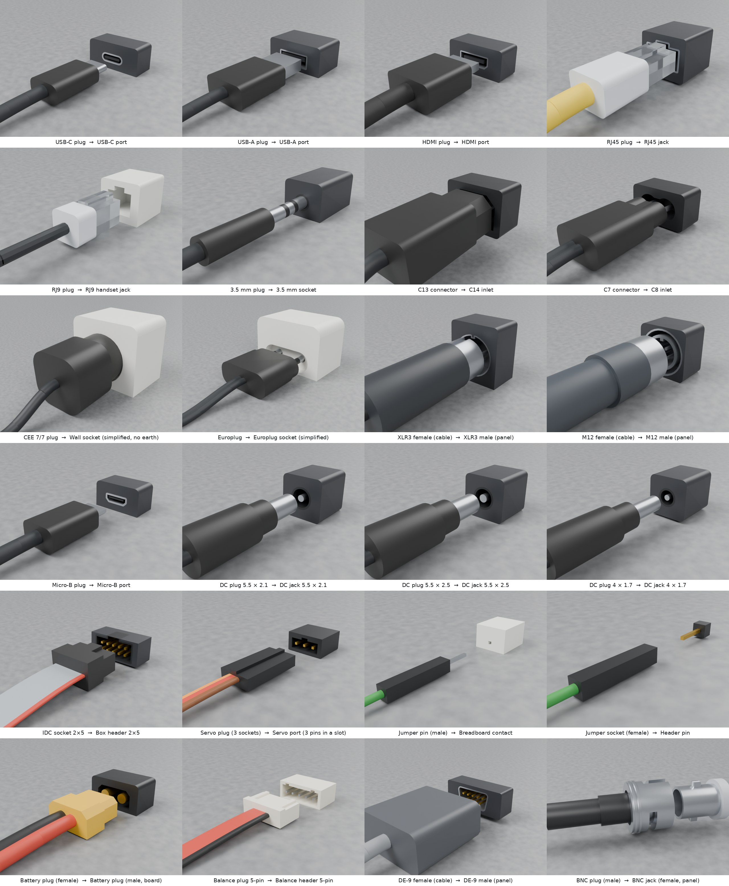
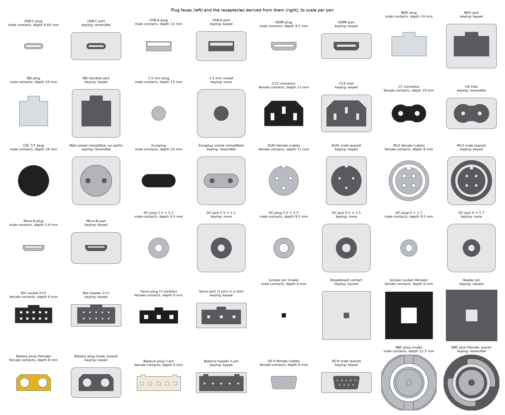

# Connectors

The 24 connector families and their end variants: dimensions, sources, keying, and what is simplified.

Part of the [Filaire](../README.md) documentation.

## Connectors

*The 24 connector families: each plug on a short piece of its cable, 15 mm
in front of the fixed receptacle derived from it (`sockets.usdc`), rendered
in Blender. The BNC plug is seen from the side, its bayonet slots in line with
the jack's studs.*

**Looks of the real parts.** Ports have a metal shell around their opening
(USB, HDMI, RJ45, XLR, M12) in a dark device face; power inlets are black
with metal pins, DC jacks black with a metal centre pin, the IDC header black
with gold pins, servo ports, jumper headers and D-sub panels with gold pins, the
breadboard white, and wall sockets white. The battery plug is yellow nylon, the
balance plug natural white. The BNC plug and jack are bare nickel-plated
metal, the plug with a black boot. Power plugs have bare metal pins
(the Europlug's with insulated sleeves), XLR and M12 plugs a black insert in
their metal rim, and male XLR and M12 receptacles metal pins. The tongue or
insert inside a receptacle has its own colour, the 3.5 mm plug its two
insulator rings, and RJ45 and RJ9 plugs are clear plastic (UsdPreviewSurface `opacity` and `ior`).
These looks are visual only: the same solids are cut by colour, so the
colliders, masses and insertion results do not depend on them.

| Family | Cable side (plug) | Contacts | Receptacle on a cable | Fixed receptacle | Keying | Depth |
|---|---|---|---|---|---|---|
| `usb_c` | USB-C plug | male | USB-C receptacle | USB-C port | reversible | 6.65 mm |
| `usb_a` | USB-A plug | male | | USB-A port | keyed | 12 mm |
| `usb_micro` | Micro-B plug | male | | Micro-B port | keyed | 5.6 mm |
| `hdmi_a` | HDMI plug | male | HDMI receptacle | HDMI port | keyed | 9.5 mm |
| `rj45` | RJ45 plug | male | RJ45 coupler | RJ45 jack | keyed | 14 mm |
| `rj9` | RJ9 plug | male | | RJ9 handset jack | keyed | 10 mm |
| `jack35` | 3.5 mm plug | male | 3.5 mm socket | 3.5 mm socket | none | 15 mm |
| `c13` | C13 connector | **female** | C14 plug | C14 inlet | keyed | 13 mm |
| `c7` | C7 connector | **female** | | C8 inlet | reversible | 10 mm |
| `cee77` | CEE 7/7 plug | male | | wall socket (simplified) | reversible | 34 mm |
| `cee716` | Europlug | male | | Europlug socket (simplified) | reversible | 25 mm |
| `xlr3` | XLR3 female | **female** | XLR3 male | XLR3 male (panel) | keyed | 11 mm |
| `m12a` | M12 A-coded female | **female** | | M12 male (panel) | keyed | 8 mm |
| `idc10` | IDC socket 2 × 5 | **female** | | box header 2 × 5 | keyed | 6 mm |
| `dc5521`, `dc5525`, `dc4017` | DC plug 5.5 × 2.1, 5.5 × 2.5, 4.0 × 1.7 mm | male | DC jack | DC jack | none | 9.5 mm |
| `dsub9` | DE-9 female | **female** | DE-9 male | DE-9 male (panel) | keyed | 6 mm |
| `servo3` | servo plug, 3 sockets 2.54 mm | **female** | servo extension (3 pins) | servo port (3 pins in a slot) | keyed | 6 mm |
| `pin_m` | jumper pin | male | jumper socket | breadboard contact | square | 6 mm |
| `pin_f` | jumper socket | **female** | | header pin | square | 6 mm |
| `batt35` | battery plug, 3.5 mm bullets (60 A class) | **female** | battery plug, male | battery plug, male (board) | keyed | 8 mm |
| `bal5` | balance plug 5-pin 2.5 mm | **female** | | balance header (charger, BMS) | keyed | 6 mm |
| `bnc` | BNC plug, 50 Ω | male | BNC jack | BNC jack (panel) | reversible, **bayonet: quarter turn to lock** | 11.5 mm |

**Gender and role are kept apart.** *Gender* is the contact gender of the
standard; *role* is geometric: the plug enters, the receptacle receives. An
IEC C13 has female contacts but enters the C14 inlet; an XLR3 female enters
the shell of the male. `filaire:contactGender` and `filaire:role` say both.

**The receptacle is derived from the plug.** Each plug is described by its
cross-sections, layer by layer from the tip (a CEE 7/7 plug: two pins, then
the round face that enters the socket's recess). In each layer, the
receptacle's solid is its outline minus the plug's cross-section grown by
the clearance (0.05–0.3 mm). The plug's holes become the receptacle's pins
or tongue, the plug's key becomes the keyway, and the two always mate. The
keying is then *found* by turning the plug in 15° steps and testing for
overlap, and a test checks it against the standard's.

The same test answers which plug goes into which receptacle across families
(`fits(plug, angle, socket=other)`). For the DC barrels it gives the real
behaviour: the derived jacks get a centre pin from the plug's bore, so a
5.5 × 2.5 mm plug goes loosely onto a 5.5 × 2.1 mm jack, while a 5.5 × 2.1 mm
plug is stopped by the thicker pin of a 5.5 × 2.5 mm jack.

*`filaire connectors`: the plug seen from its tip (left) and the fixed
receptacle seen from the front (right): opening in dark, pins and tongues in
light grey.*

Dimensions come from published figures where they could be found (USB-C
receptacle opening and insertion length, HDMI plug and receptacle, RJ45 and
RJ9 widths and heights, 3.5 mm diameter and length, CEE 7 pins and recess
depth, IEC 60320 pin spacing, Micro-B receptacle opening, DC barrel diameters
and the 4.0 × 1.7 mm barrel length, D-sub shell and flange and its 2.77 mm pitch,
2.54 mm and 2.5 mm header pitches and 0.64 mm posts, the battery plug's 7.2 mm
pitch, the BNC barrel, sleeve, pin and coupling nut diameters and its quarter
turn); the others (XLR, M12, IDC, C13 face, Micro-B chamfers, 5.5 mm barrel
length, servo, jumper, battery and balance housings, BNC studs and slots,
inner cavities, overmolds) are **approximate** and marked so in
[`connectors.py`](https://github.com/drscaon/filaire/blob/main/src/filaire/connectors.py), each with its sources. The
standards themselves were not consulted. Connectors are simplified: no
latches that move, no threads, no contacts inside the holes, no logos.
Families that come from one maker's product line are given generic names
(battery plug, balance plug, jumper wire), with their geometry drawn from
public dimensions.
