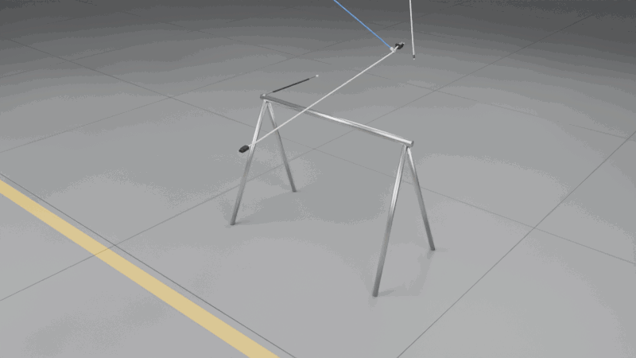
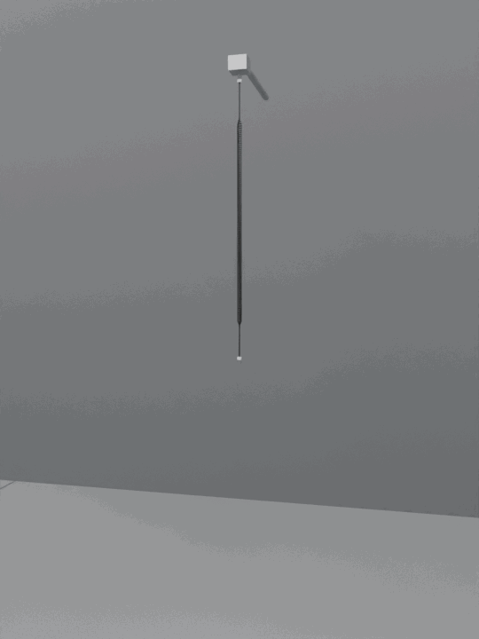

# Physics: model and checks

The rod model, the Blender add-on, the MuJoCo and Blender checks with their results, and how to check a preset against a real cable.

Part of the [Filaire](../README.md) documentation.

## Physics model

- **Rod.** The cable is a chain of N rigid segments (length ≈ 1.5 cable
  widths, at most 400 per cable). Consecutive segments share a joint at
  their common end point with three rotational springs: twist `G·J / L`,
  bending `E·I_y / L` and `E·I_z / L`, the discrete Kirchhoff rod. `E·I` and
  `G·J` come from the cross-section (polygon second moments, so a flat
  ribbon is a hundred times softer across its thickness than across its
  width) and an effective modulus drawn per cable; `G = E / (2 (1 + ν))`,
  ν = 0.45. The rest shape is straight; the authored pose (slack, coiled) is
  a deformed state.
- **Coiled cords** are modelled along their axis, as a helical spring seen
  as a rod (Wahl's close-coiled formulas): bending `2 E I p / (π D (2 + ν))`,
  twist `E I p / (π D)`, and an axial spring `4 G J / (π D³ n)` shared by
  free `transX` joints, limited (`PhysicsLimitAPI`) from 0 (a close-coiled cord
  does not compress: its turns touch) to the stretch at which the wire is
  straight. The coil itself is in the visual mesh. As on a real
  handset cord, each plug is on a straight lead of bare wire (4–8 cm, drawn
  per end, added to the coiled length): there the joints bend and twist like
  the wire (`E I`, `G J`), do not stretch, and the segments weigh and collide
  as the wire; the coil opens out of the lead over about one coil diameter.
- **Masses** from the linear density; connectors from the volume of their
  parts and an effective density; inertia tensors from the meshes.

## Blender

Blender's USD importer reads geometry and materials but ignores UsdPhysics:
imported as is, a cable is a heap of loose tube pieces and its connectors
fall off (see the comparison below). The add-on, adapted from
Quincaillerie's, sets the physics up once and for all:

1. `filaire blender-addon` writes `filaire_physics.zip`.
2. In Blender (4.4 or later): Edit > Preferences > Get Extensions > Install
   from Disk, pick the zip.
3. File > Import > Universal Scene Description, as usual: every segment and
   connector gets its rigid body, every joint its constraint. Press Play.

On import it moves each body's origin to its centre of mass (Blender uses
the origin as centre of mass), makes its collision shape a compound of the
USD shapes (capsules, boxes and convex hulls rebuilt from the file), sets
mass, friction and small collision margins, turns the cable joints into
Generic Spring constraints with the USD drives' stiffness and damping
(translations locked; a coiled cord's axial spring kept) and the connectors'
fixed joints into Fixed constraints, and runs the rigid body world at 4000
substeps per second for the light segments. The same file runs as a script
(`blender -b -P filaire_physics.py -- file.usdc`) without installing.

Bullet takes a spring's rest position from the first frame, so in Blender a
cable keeps the shape it was generated in (coiled, slack) as its rest shape,
where the file and MuJoCo say straight: a coiled cable stays coiled.

## MuJoCo checks

`filaire sim-test output/<preset>` reads the OpenUSD files back (not the
generator's objects) and runs, on CPU:

| Check | What | Pass when |
|---|---|---|
| drop | the first cables, with their selected ends, lifted 1 cm and dropped for 3 s in their authored layout | finite, ground penetration below half the cable radius after the impact, all bodies slower than 5 cm/s at the end |
| sag | a sample of the cable clamped at one end, sagging ≈ 10 % of its length under its own weight; `E·I` read back from the joint drives | tip deflection within 5 % of `w L⁴ / (8 E I)` |
| coil | coiled cords: the coil hanging from its top | extension within 5 % of `W / (2 k)` |
| insertion | each plug pushed along its axis (5 N max) into the fixed receptacle and the receptacle on a cable, at 0°, 90° and 180° | goes fully in at the angles its keying allows, stopped before 60 % of the depth at the others |
| lock | bayonets: pushed fully in, turned by the locking angle (0.05 N·m max), then pulled back with 5 N; and pulled without the turn | turned, stays more than 90 % in; not turned, comes out |

For speed, the drop test simulates the cable with at most 60 links (groups
of segments merged, springs in series, same `E·I`) and without the twist
hinge: in generalised coordinates a chain's mass matrix is dense and a step
costs the cube of its joints. Each joint gets an armature (added inertia)
and critical damping so that stiff, light links stay stable with a 1 ms
step; neither changes a static equilibrium, which is what the sag and coil
checks compare.



*Power cord, coiled handset cord, Cat 6, USB-C, 3.5 mm jack and M12 sensor
cable (1.5 m; the coiled cord 35 cm of coil), dropped together onto a steel
swing-set frame from different heights and in very different orientations
(flat or steep, across or along the beam, turned about their own axis). The
power cord and the coiled cord land across the beam and stay there, the coil
stretched by its own weight; the others hit an end first, glance off the beam
or a leg and pile up on the floor. Simulated in MuJoCo from the OpenUSD files
(rest shape straight, up to 60 links per cable, 0.5 ms step), rendered in
Blender:
[`scripts/drop_gif.py`](https://github.com/drscaon/filaire/blob/main/scripts/drop_gif.py).*



*A coiled handset cord hangs from its top plug, a gripper pulls the bottom
plug 45 cm down and lets go. Nothing is scripted after the release: the coil
springs back on its axial spring, cannot shorten past its touching turns,
bounces a few times and settles on its hanging length. Simulated in MuJoCo
from the OpenUSD file, rendered in Blender:
[`scripts/coil_gif.py`](https://github.com/drscaon/filaire/blob/main/scripts/coil_gif.py).*

### Results

`filaire generate --preset <p> --count 3` (1 m cables, seed 1) then
`filaire sim-test output/<p> --cables 3`, one CPU core; measured with MuJoCo
3.17, before 4.0 (CI runs every check on MuJoCo 4):

| Preset | Segments | `E·I` (N·m²) | Mass with ends (g) | Drop (max speed, penetration) | Stiffness check | Insertion |
|---|---|---|---|---|---|---|
| `power_c13` | 104 | 0.0049–0.0073 | 119–187 | 3/3 (0.004 m/s, 0.10 mm) | sag −0.8 % | C13 panel + inline, CEE 7/7 ✓ |
| `power_c7` | 98 | 0.00066–0.00098 | 49–67 | 3/3 (0.002 m/s, 0.06 mm) | sag −0.8 % | C7, Europlug ✓ |
| `dc_barrel` | 139 | 0.00016–0.00026 | 30–33 | 3/3 (0.012 m/s, 0.09 mm) | sag −0.8 % | three DC jacks ✓ |
| `usb_c` | 167 | 0.00050–0.00080 | 46–50 | 3/3 (0.013 m/s, 0.18 mm) | sag −0.8 % | USB-C panel + inline ✓ |
| `usb_a_to_c` | 175 | 0.00041–0.00065 | 43–46 | 3/3 (0.004 m/s, 0.18 mm) | sag −0.8 % | USB-A, USB-C ✓ |
| `usb_micro` | 190 | 0.00029–0.00051 | 38–40 | 3/3 (0.004 m/s, 0.10 mm) | sag −0.8 % | USB-A, Micro-B ✓ |
| `ethernet` | 111 | 0.0050–0.0072 | 61–70 | 3/3 (0.005 m/s, 0.07 mm) | sag −0.8 % | RJ45 panel + inline ✓ |
| `hdmi` | 95 | 0.0094–0.0139 | 99–107 | 3/3 (0.005 m/s, 0.09 mm) | sag −0.8 % | HDMI panel + inline ✓ |
| `audio_jack` | 190 | 0.00022–0.00036 | 20–22 | 3/3 (0.003 m/s, 0.13 mm) | sag −0.8 % | 3.5 mm panel + inline ✓ |
| `xlr_mic` | 111 | 0.0013–0.0022 | 147–151 | 3/3 (0.007 m/s, 0.06 mm) | sag −0.8 % | XLR3 panel + inline ✓ |
| `speaker_wire` | 104 | 0.00042–0.00067 | 52–55 | 3/3 (0.024 m/s, 0.07 mm) | sag −0.8 % | (stripped / cut ends) |
| `m12_sensor` | 133 | 0.0015–0.0023 | 65–68 | 3/3 (0.004 m/s, 0.03 mm) | sag −0.8 % | M12 ✓ |
| `ribbon_idc` | 52 | 0.00011–0.00017 | 14–16 | 3/3 (0.007 m/s, 0.06 mm) | sag −0.8 % | IDC ✓ |
| `coiled_handset` | 59 | (coil) | 130–139 | 3/3 (0.004 m/s, 0.07 mm) | coil −0.0 % | RJ9 ✓ |

Every keyed connector was stopped at 90° and 180° (at most 12 % of its
depth, the IDC socket's flat face entering a little before its key meets the
header), every reversible one went in at 180°, the 3.5 mm jack at every
angle, like the DC barrels. The sag is 0.8 % under the linear beam formula for every cable: the
geometric nonlinearity of a 10 % deflection, the same for all since the
sample length is scaled to the stiffness. Generation takes 1–4 s per
preset (3 cables), the checks 15–30 s (a minute for the coiled cords).

### Blender checks

`filaire blender-test output/<preset>` builds, for each tested cable, a scene
that references the cable file, keeps that cable (with its selected ends),
lifts it 2 cm and drops it on the ground, then simulates it in Blender
(Bullet) through the add-on, in its own process:

| Check | Pass when |
|---|---|
| joints hold | the two bodies of every joint meet within 0.5 mm at its anchor, the connectors' fixed joints included |
| at rest on the ground | no point more than 0.5 mm under the ground, every body slower than 5 cm/s after 1.5 s |

`--mode naive` imports the same scene the way one would by hand (File >
Import > USD, every mesh an active rigid body, the ground passive) and
reports how far neighbouring pieces drift apart.

`filaire generate --preset <p> --count 2` (1 m cables, seed 1), then
`filaire blender-test output/<p> --cables 2` and `--mode naive` on the
first cable, Blender 5.2 (`bpy`), one CPU core:

| Preset | Through the add-on | Bodies | Widest joint gap (mm) | Lowest point (mm) | Rigid bodies by hand: pieces drifted apart (mm) | Time per cable (s) |
|---|---|---|---|---|---|---|
| `power_c13` | 2/2 | 106 | 0.005 | −0.09 | 145 | 18 |
| `power_c7` | 2/2 | 100 | 0.006 | +0.02 | 180 | 17 |
| `dc_barrel` | 2/2 | 141 | 0.009 | +0.05 | 174 | 30 |
| `usb_c` | 2/2 | 169 | 0.005 | +0.04 | 58 | 42 |
| `usb_a_to_c` | 2/2 | 177 | 0.005 | +0.04 | 32 | 44 |
| `usb_micro` | 2/2 | 192 | 0.006 | +0.04 | 35 | 47 |
| `ethernet` | 2/2 | 113 | 0.005 | +0.01 | 40 | 21 |
| `hdmi` | 2/2 | 97 | 0.002 | +0.03 | 40 | 16 |
| `audio_jack` | 2/2 | 192 | 0.006 | +0.04 | 162 | 48 |
| `xlr_mic` | 2/2 | 113 | 0.008 | −0.03 | 1634 | 21 |
| `speaker_wire` | 2/2 | 105 | < 0.001 | +0.05 | 10 | 18 |
| `m12_sensor` | 2/2 | 135 | 0.007 | +0.02 | 818 | 25 |
| `ribbon_idc` | 2/2 | 54 | < 0.001 | −0.05 | 1240 | 7 |
| `coiled_handset` | 2/2 | 61 | 0.104 (axial spring) | −0.10 | 2193 | 10 |

Through the add-on every cable holds together and comes to rest (a coiled
cord's joints stretch along its axial spring, by design). Set up by hand,
the pieces are independent: they spread over the floor, and where a heavy
connector or a coil's overlapping pieces push on them, they are thrown
metres away. The checks found a real defect of the first beta: on tight
curves the rigid segments, as long as the arc they stand for, overlapped
their neighbours by up to 0.4 mm at the joints; each segment now spans the
chord between its joints.

## Checking a preset against a real cable

A search of the literature (November 2026) found no measured bending
stiffness for USB, Ethernet, HDMI or power cords by type. What is published
sits in the same range as the presets (7.6e-6 to 1.4e-2 N·m²) but does not
calibrate any of them:

| Object | `E·I` (N·m²) | Source |
|---|---|---|
| Optical-fibre drop cable, fibre element | 8e-5 to 5e-4 | [US 6853782](https://image-ppubs.uspto.gov/dirsearch-public/print/downloadPdf/6853782) |
| Flexible cable in a robot manipulation study, 13 g/m | 2.7e-3 | [arXiv 2502.07509](https://arxiv.org/abs/2502.07509) |
| Ropes 11–12 mm, 37–41 g/m | 1.7e-2 to 4.7e-2 | [arXiv 2605.06323](https://arxiv.org/abs/2605.06323) |

A ruler is enough to measure a cable yourself (Peirce's cantilever test).
Straighten the cable, lay it on a table and slide it over the edge until
the line from the edge to the tip points 41.5° below horizontal. With `l`
the overhanging length and `m` the mass per metre:

```
E·I = m · g · (l / 2)³
```

Turn the cable half a turn and repeat, to average out the curl it keeps from
its coil. The overhang each preset predicts at its central modulus (weaker
bending axis for flat cables; the coiled cord is left out, the test needs a
straight cable):

| Preset | `E·I` (N·m²) | Mass (g/m) | Overhang at 41.5° (cm) |
|---|---|---|---|
| `power_c13` | 7.3e-03 | 82.5 | 42 |
| `power_c7` | 9.9e-04 | 35.0 | 28 |
| `dc_barrel` | 2.4e-04 | 23.0 | 21 |
| `usb_c` | 8.1e-04 | 37.5 | 26 |
| `usb_micro` | 4.7e-04 | 27.5 | 24 |
| `usb_a_to_c` | 6.6e-04 | 32.5 | 25 |
| `ethernet` | 7.2e-03 | 47.5 | 50 |
| `hdmi` | 1.4e-02 | 75.0 | 53 |
| `audio_jack` | 3.6e-04 | 16.0 | 26 |
| `xlr_mic` | 2.2e-03 | 60.0 | 31 |
| `speaker_wire` | 6.7e-04 | 47.5 | 23 |
| `m12_sensor` | 2.3e-03 | 42.5 | 35 |
| `ribbon_idc` | 1.7e-04 | 10.0 | 24 |
| `can_bus` | 4.0e-03 | 47.5 | 41 |
| `servo_lead` | 1.2e-05 | 5.5 | 12 |
| `jumper_wire` | 7.6e-06 | 2.5 | 14 |
| `battery_lead` | 4.4e-04 | 72.5 | 17 |
| `balance_lead` | 1.4e-05 | 13.5 | 9 |
| `bnc_coax` | 5.8e-03 | 39.0 | 50 |

If your cable overhangs a length `l'` instead, scale the modulus by
`(l' / l)³` with `--modulus`.
