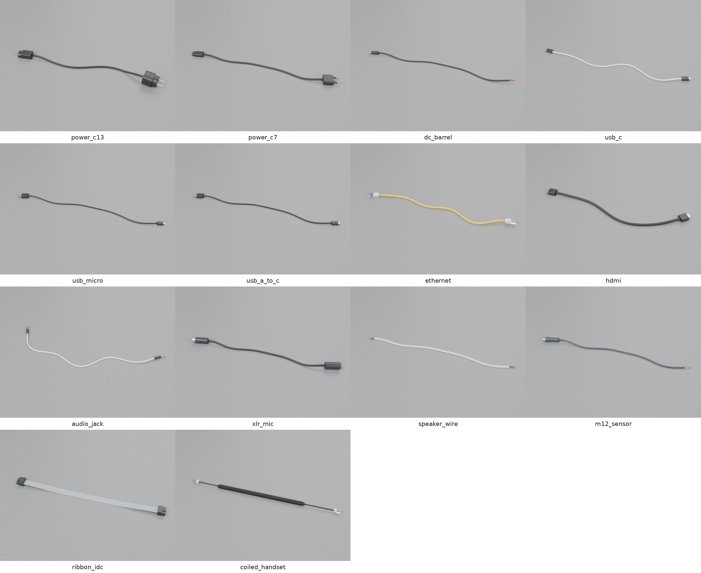

# Usage in depth

Every option of `filaire generate` and the preset list.

Part of the [Filaire](../README.md) documentation.

## Options of `filaire generate`

| Option | Default | Effect |
|---|---|---|
| `--preset` | `usb_c` | cable type (table below) |
| `--count N`, `--seed S` | 6, 1 | number of cables, random seed; same options and seed give the same cables |
| `--length L` | `1` | length in m of every cable; `preset` draws the preset's retail lengths (± tolerance) |
| `--end-a V`, `--end-b V` | preset's draw | end variant of each end, independently: any `filaire ends` entry, on any cable |
| `--layout` | preset's draw | `straight`, `slack` (random smooth curve) or `coil` (flat spiral on the floor) |
| `--color "#rrggbb"` | preset's draw | jacket colour of every cable |
| `--modulus E` | preset's draw | effective Young's modulus of the cable in MPa (sets the stiffness) |
| `--max-segments N` | 400 | upper bound on the rigid segments per cable (longer segments beyond it) |
| `--no-physics` | | visual assets only: no rigid bodies, colliders, joints, physics scene or ground |
| `--no-vary-…` | | turn one random aspect off, the others unchanged: `layout`, `ends`, `color`, `stiffness`, `density`, `length` |

Each random aspect has its own stream: turning one off or forcing it leaves
the others as they were (same layouts with plain colours, same colours with
other ends…).

## Presets

| Category | Preset | Cross-section | End A | End B (default draw) |
|---|---|---|---|---|
| Power | `power_c13` | round Ø6.4 mm, 3 cores | C13 | CEE 7/7 plug, C14 (extension), stripped |
| | `power_c7` | figure-8, 2 × Ø3.4 mm | C7 | Europlug, stripped |
| | `dc_barrel` | figure-8, 2 × Ø2.4 mm | DC plug 5.5 × 2.1, 5.5 × 2.5 or 4.0 × 1.7 | stripped, cut, DC jack (extension) |
| Data | `usb_c` | round Ø4.0 mm | USB-C plug | USB-C plug, USB-C receptacle (extension) |
| | `usb_a_to_c` | round Ø3.8 mm | USB-A plug | USB-C plug |
| | `usb_micro` | round Ø3.5 mm | USB-A plug | Micro-B plug |
| | `ethernet` | round Ø6.0 mm, 4 pairs | RJ45 plug | RJ45 plug, RJ45 coupler |
| | `hdmi` | round Ø7.0 mm | HDMI plug | HDMI plug, HDMI receptacle (extension) |
| Audio | `audio_jack` | round Ø3.5 mm | 3.5 mm plug | 3.5 mm plug, 3.5 mm socket (extension) |
| | `xlr_mic` | round Ø6.0 mm | XLR3 female | XLR3 male |
| | `speaker_wire` | figure-8, 2 × Ø3.2 mm | stripped, cut | stripped, cut |
| Industrial | `m12_sensor` | round Ø5.0 mm, PUR | M12 female | stripped, cut |
| | `ribbon_idc` | flat, 10 × 1.27 mm, wire 1 red | IDC socket 2 × 5 | IDC socket, cut |
| | `can_bus` | round Ø5.5 mm, PUR | DE-9 female | DE-9 female, DE-9 male (extension), stripped |
| Robotics | `servo_lead` | flat, 3 × 1.05 mm: brown, red, orange (or black, red, white) | servo plug (3 sockets) | servo extension (3 pins), cut, stripped |
| | `jumper_wire` | round Ø1.3 mm | jumper pin or socket | jumper pin, jumper socket |
| | `battery_lead` | figure-8, 2 × Ø4.0 mm silicone, red and black | battery plug, female (3.5 mm bullets) | stripped, battery plug male (extension) |
| | `balance_lead` | flat, 5 × 1.2 mm silicone, black and 4 red | balance plug 5-pin 2.5 mm (4S) | stripped, cut |
| Lab | `bnc_coax` | round Ø4.95 mm (RG-58), stiff | BNC plug | BNC plug, BNC jack (extension), stripped |
| Telephone | `coiled_handset` | coil Ø8.5 mm of Ø2.8 mm wire, straight 4–8 cm leads | RJ9 plug | RJ9 plug |

Every cable also carries `cut` and `stripped` variants on both ends, and any
other variant forced with `--end-a` / `--end-b`. Diameters, densities
(2–90 g/m) and moduli (10–300 MPa, drawn per cable) are realistic orders of
magnitude, not measurements of a specific product.

*Each preset with its usual ends (the first variant of each end), 40 cm
long (shorter for the ribbon, the robot leads and the jumper wire; 25 cm of coil for the
coiled cord), rendered in Blender. Flat and figure-8 cables keep a colour per wire
(the `stripes` of a preset).*
